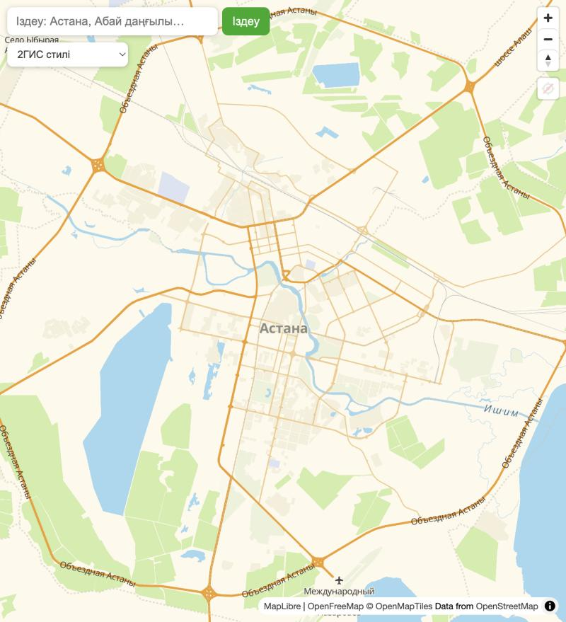
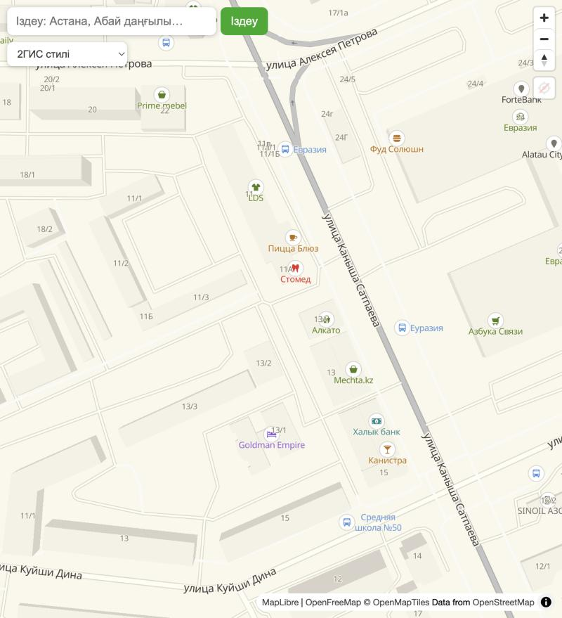
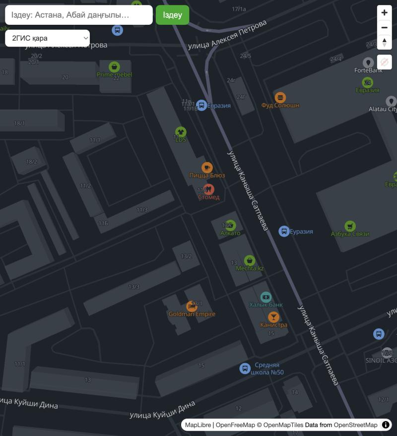

# OSM · 2ГИС-ке ұқсас стиль

OpenStreetMap деректеріне арналған **2ГИС стилистикасынан шабыттанған** ашық MapLibre картасы: ашық және қара тақырып, POI иконкалары, үй нөмірлері және такси қосымшасына арналған қабаттар (A → B маршрут, баға, көліктер, сұраныс аймақтары).

> **English:** An open-source MapLibre GL style for OpenStreetMap data, *inspired by* the look of 2GIS (light + dark themes, POI icons, house numbers) with a small taxi-app demo layer set (A → B route, fare estimate, driver markers, surge zones). No build step — plain HTML/JS. Not affiliated with 2GIS.

**Демо:** https://taxi-map-lovat.vercel.app

| Қала (zoom 10) | Көшелер мен иконкалар (zoom 16.6) | Қара тақырып |
|---|---|---|
|  |  |  |

## Мүмкіндіктері

- **2ГИС түстері:** кіші масштабта қызғылт сары жолдар мен жылы крем фон, үлкен масштабта ақ/сұр жолдар. Екі палитра да 2ГИС скриншоттарынан пиксельдер бойынша өлшенген (`LIGHT`, `DARK` — `src/style.js`).
- **Ашық және қара тақырып** (`2gis`, `2gis-dark`).
- **POI иконкалары:** [Maki](https://github.com/mapbox/maki) (CC0) жиынтығынан, санат түсімен (тамақ — қызғылт сары, дүкен — жасыл, денсаулық — қызыл, ...).
- **Үй нөмірлері** zoom 16-дан, басқа жазулармен қабаттасса да жасырылмайды.
- **Жазулар бір тілде** (`LANG = 'ru' | 'kk' | 'en'`) — ұзын қос тілді атаулар көшеге сыймай жоғалмайды.
- **Стиль таңдағыш:** 2ГИС-ке ұқсас екі стиль + Liberty, Bright, Positron, VersaTiles Colorful/Dark/Gray/Muted.
- **Такси қабаттары:** A/B белгілері (сүйреуге болады), OSRM маршрут, баға, көліктер, сұраныс аймақтары, геолокация батырмасы.
- Құрастыру қадамы жоқ: `index.html` + екі `.js` файл + CDN-нен MapLibre.

## Іске қосу

`file://` арқылы ашуға болмайды (OSM тайл сервері `Referer` талап етеді), жергілікті сервер қажет:

```bash
git clone https://github.com/Azamaperdeev05/osm-2gis-inspired-style.git
cd osm-2gis-inspired-style
python3 -m http.server 8000
```

Содан кейін http://localhost:8000 адресін ашыңыз. Карта жағдайы адрес жолында сақталады (`#zoom/lat/lng`), сілтемені бөлісуге болады.

## Өз жобаңызда қолдану

Стильдің өзегі — `src/style.js` (тәуелсіз, MapLibre ғана керек):

```html
<script src="https://unpkg.com/maplibre-gl@4.7.1/dist/maplibre-gl.js"></script>
<script src="style.js"></script>
<script>
  (async () => {
    const [style] = await Promise.all([loadStyle('2gis-dark'), loadIcons()]); // '2gis' немесе '2gis-dark'
    const map = new maplibregl.Map({ container: 'map', style, center: [71.43, 51.13], zoom: 15 });
    // POI иконкалары стиль жүктелгенде сұралады:
    map.on('styleimagemissing', e => {
      if (ICONS[e.id] && !map.hasImage(e.id)) map.addImage(e.id, ICONS[e.id], { pixelRatio: 2 });
    });
  })();
</script>
```

Түстерді өзгерту: `src/style.js` басындағы `LIGHT` / `DARK` объектілері. Жаңа POI санатын қосу: `POI` кестесіне `{ osm_класы: 'maki-иконка' }` жолын жазыңыз.

### Такси қабаттарын серверге қосу

`src/app.js` ішінде `window.taxi` объектісі бар:

```js
taxi.setDrivers([{ lng: 71.43, lat: 51.13, heading: 90 }]); // көліктер
taxi.setSurge(geojsonPolygons);                            // сұраныс аймақтары, properties.k — коэффициент
```

Тариф — `TARIFF` объектісі (`src/app.js`): `base`, `perKm`, `perMin`, `cur`. Қазір ол жорамал мән, өз тарифіңізге ауыстырыңыз.

## Жоба құрылымы

```
index.html      беттің сүйегі
src/style.js    палитралар, POI иконкалары, loadStyle() — стильдің өзегі
src/app.js      демо: карта, таңдағыш, A → B маршрут, такси қабаттары
src/app.css     демо интерфейсі
docs/           README скриншоттары
```

## Шектеулер

- **Деректер:** карта OSM-ге негізделген, сондықтан кей жерде (үй нөмірі, санат, жол жолақтары) 2ГИС-тен өзгеше, 2ГИС-тің өз деректері жоқ.
- **Иконкалар:** 2ГИС иконкалары қолданылмайды, Maki жиынтығы 2ГИС-ке тек түс бойынша ұқсайды.
- **Zoom 17+:** 2ГИС-тің жол жолақтары, ағаштар, түрлі түсті 3D үйлері жоқ.
- **Қызметтер:** OpenFreeMap тайлдары, OSRM демо-сервері және Nominatim — ашық тегін қызметтер, кепілсіз. Нақты өнімде тайлдарды (мысалы, [Planetiler](https://github.com/onthegomap/planetiler) + PMTiles), OSRM мен Nominatim-ді өзіңіз орналастырыңыз.
- **Трафик:** кептеліс қабаты жоқ (тегін ашық дерек көзі жоқ).

## Лицензия және атрибуция

Код — [MIT](LICENSE), © 2026 [Azamat Perdeev](https://github.com/Azamaperdeev05).

Карта деректері © [OpenStreetMap contributors](https://www.openstreetmap.org/copyright) (ODbL). Картада атрибуцияны әрқашан көрсетіңіз (MapLibre оны өзі шығарады). Үшінші тарап ресурстары мен лицензиялары: [NOTICE.md](NOTICE.md).

**Бұл жоба 2ГИС-пен байланысты емес**, оны 2ГИС қолдамайды. «2ГИС» — өз иелерінің сауда белгісі; жобада 2ГИС-тің деректері, иконкалары, тайлдары мен қайнар коды қолданылмайды.

## Үлес қосу

Issue мен pull request қуанышпен қабылданады: түс түзетулері (скриншотпен), жаңа POI санаттары, басқа қалалар үшін тексеру.
